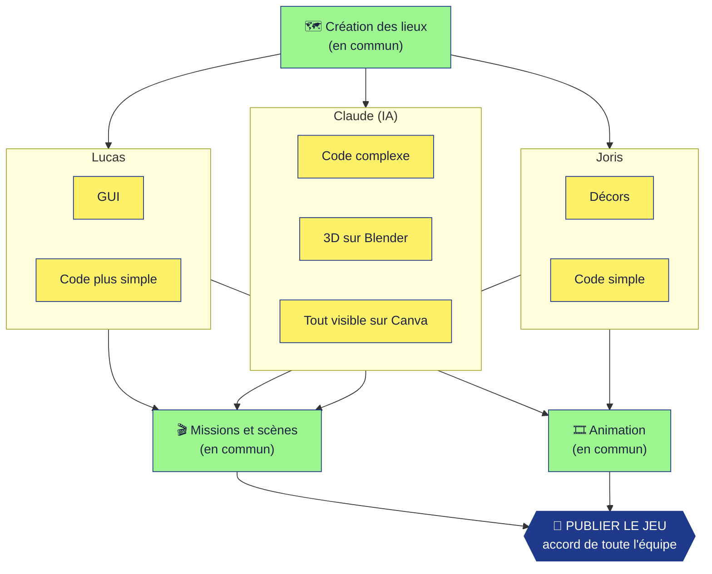

# 👥 L'équipe

> ✏️ **Version interactive et modifiable** : [Feuille de route de l'équipe](https://claude.ai/artifact/KrK8tNvMBfhzWVieRz8o5H)
> (rôles, tâches à faire / en cours / faites, et votes pour la publication. Il faut que le propriétaire la partage avec toi.)

## Qui fait quoi

🟨 jaune : rôle d'une personne · 🟩 vert : en commun

## Les rôles

| | Rôle | Missions |
|---|---|---|
| 🤖 **Claude (IA)** | Code complexe et 3D | Code complexe et toutes les tâches complexes · création 3D sur Blender · toute création doit être visible sur Canva · aider à ajouter des membres |
| 🎮 **Lucas** | Code plus simple et interfaces | Code plus soft · GUI avec code superficiel · animations avec toute l'équipe |
| 🏰 **Joris** | Décors | Création des décors · code superficiel · animation en équipe |
| 🤝 **En commun** | Toute l'équipe | Création des lieux · missions et scènes · animation |

## ✅ Tâches

Copie de la feuille de route interactive au 17/11/2026.

| Statut | Tâche | Qui |
|---|---|---|
| ⬜ À faire | Vérifier que Blender est installé pour la création 3D | Claude |
| ✅ Fait | Île géante et cité fortifiée style SNK (mur de 160 studs, 842 maisons) | Claude |
| ✅ Fait | Anti-lag : fusion des maisons et arbres (25 451 → 8 768 pièces) | Claude |
| ✅ Fait | Bibliothèque de scripts sur GitHub + app Canva Atelier Roblox | Claude |

## 🚀 Règle de publication

**Votes actuels :** Lucas ⬜ pas encore d'accord · Joris ⬜ pas encore d'accord → publication bloquée.

**Toujours demander l'autorisation.** Pour publier le jeu, il faut l'avis et l'accord de **toute l'équipe**.
Claude ne publie jamais le jeu lui-même. Les votes se font sur la [feuille de route interactive](https://claude.ai/artifact/KrK8tNvMBfhzWVieRz8o5H).
